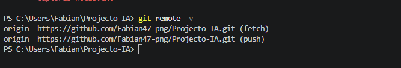
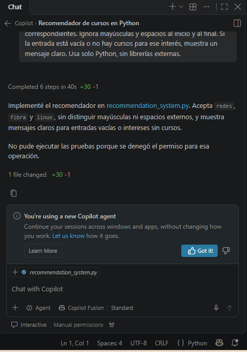
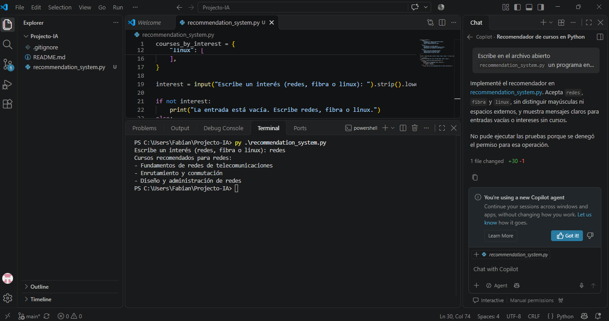

# Recomendador de cursos de telecomunicaciones

## Objetivo

Desarrollar un programa en Python que recomiende cursos de telecomunicaciones según el interés del usuario. Las opciones disponibles son redes, fibra óptica y Linux.

## Creación y clonación del repositorio

Creé el repositorio público `Projecto-IA` en GitHub con los archivos `README.md` y `.gitignore`. Desde el menú **Código → HTTPS**, copié el enlace y ejecuté estos comandos en la terminal de Visual Studio Code:

```powershell
git clone https://github.com/Fabian47-png/Projecto-IA.git
cd .\Projecto-IA
git remote -v
```

La salida de `git remote -v` mostró la URL de GitHub junto a `origin`, lo que confirmó que la copia local quedó vinculada al repositorio remoto.


## Generación del código con GitHub Copilot

Inicié sesión en GitHub Copilot desde Visual Studio Code y creé el archivo `recommendation_system.py`. Le pedí a Copilot que generara un recomendador de cursos de telecomunicaciones en Python, sin librerías externas.

El programa pide un interés y busca los cursos de esa categoría. Ignora las mayúsculas y los espacios al inicio y al final. También muestra un mensaje si el usuario deja la entrada vacía o escribe un interés sin cursos disponibles.



## Prueba del recomendador

Ejecuté el programa con Python 3.13.2 desde la terminal de Visual Studio Code:

```powershell
py .\recommendation_system.py
```

Al ingresar `redes`, el programa mostró estas tres recomendaciones:

- Fundamentos de redes de telecomunicaciones
- Enrutamiento y conmutación
- Diseño y administración de redes


